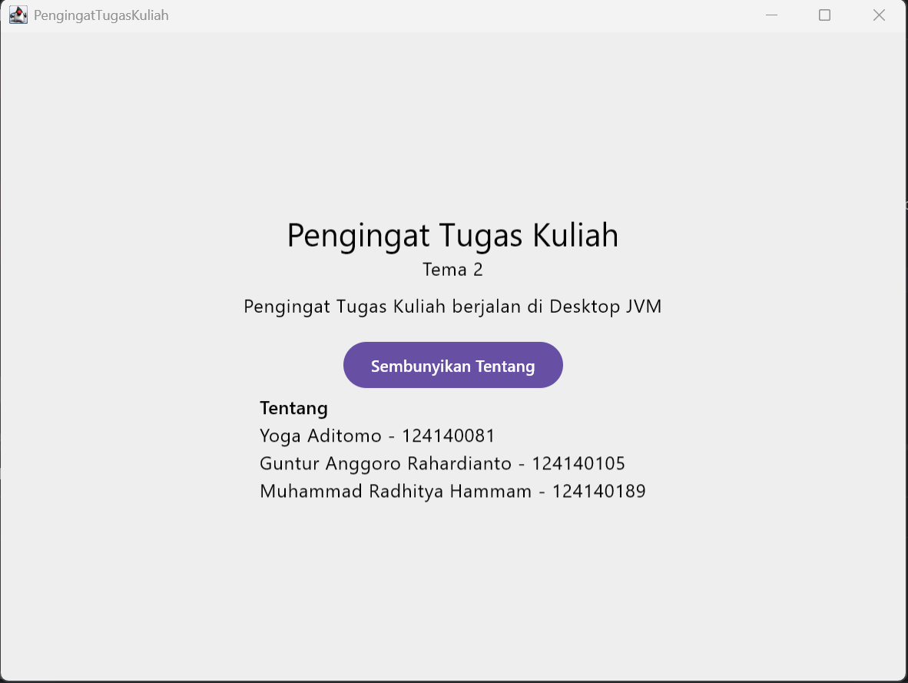

# Pengingat Tugas Kuliah

**Tema 2 | PAM Kelompok 06**

Aplikasi Kotlin Multiplatform dengan Compose Multiplatform yang menargetkan Android dan Desktop (JVM).

Proyek kelompok mata kuliah **IF25-22017 Pengembangan Aplikasi Mobile**, Program Studi Teknik Informatika, Fakultas Teknologi Industri, Institut Teknologi Sumatera (ITERA).
Dosen pengampu: Muhammad Habib Algifari, S.Kom., M.T.I.

## Tema

**Tema 2: Pengingat Tugas Kuliah**

## Anggota Kelompok

Ketua kelompok: Yoga Aditomo

| No | Nama                         | NIM       |
|----|------------------------------|-----------|
| 1  | Yoga Aditomo                 | 124140081 |
| 2  | Guntur Anggoro Rahardianto   | 124140105 |
| 3  | Muhammad Radhitya Hammam     | 124140189 |

## Tangkapan Layar

### Dekstop


## Android


## Isi Aplikasi Saat Ini

- Layar utama menampilkan judul "Pengingat Tugas Kuliah" dan "Tema 2".
- Kalimat sapaan yang menyebut nama platform tempat aplikasi berjalan, misalnya "Pengingat Tugas Kuliah berjalan di Desktop JVM".
- Tombol **Tentang** untuk menampilkan atau menyembunyikan daftar nama dan NIM anggota kelompok.


## Cara Menjalankan

1. Clone repository ini, lalu buka foldernya di Android Studio.
2. Tunggu Gradle sync selesai. Unduhan pertama bisa lama, pastikan koneksi stabil.
3. Jalankan lewat run configuration di toolbar IDE, atau lewat terminal:

**Android**

```
./gradlew :androidApp:assembleDebug
```

**Desktop** (paling cepat untuk mencoba tanpa emulator)

```
# Hot reload
./gradlew :desktopApp:hotRun --auto

# Run biasa
./gradlew :desktopApp:run
```

## Referensi

- [Kotlin Multiplatform Wizard](https://kmp.jetbrains.com)
- [Kotlin Multiplatform](https://www.jetbrains.com/help/kotlin-multiplatform-dev/get-started.html)
- Materi: Pertemuan 1, Kenalan dengan KMP dan Siapkan Alat
