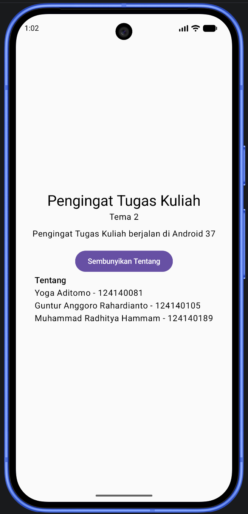
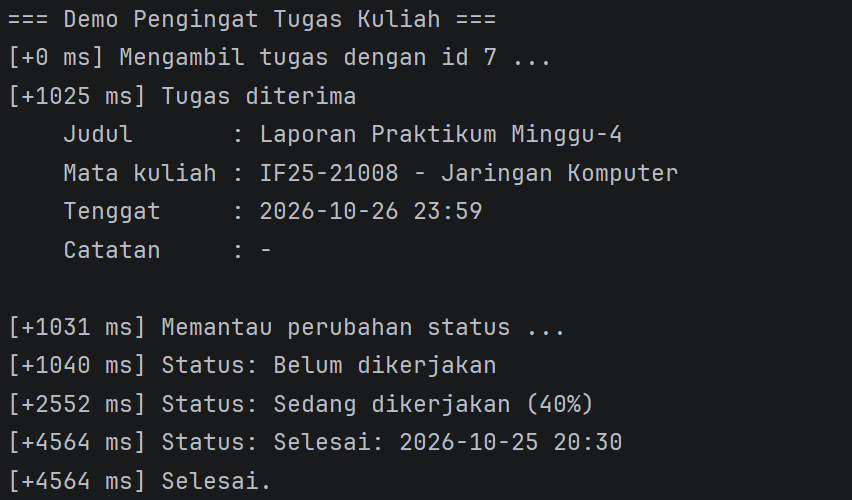

# Pengingat Tugas Kuliah

**Tema 2 | PAM Kelompok 06**

Aplikasi Kotlin Multiplatform dengan Compose Multiplatform yang menargetkan Android dan Desktop (JVM).

Proyek kelompok mata kuliah **IF25-22017 Pengembangan Aplikasi Mobile**, Program Studi Teknik Informatika, Fakultas Teknologi Industri, Institut Teknologi Sumatera (ITERA).  
Dosen pengampu: Muhammad Habib Algifari, S.Kom., M.T.I.

## Tema

**Tema 2: Pengingat Tugas Kuliah**

## Anggota Kelompok

Ketua kelompok: Yoga Aditomo

| No | Nama                         | NIM       |
|----|------------------------------|-----------|
| 1  | Yoga Aditomo                 | 124140081 |
| 2  | Guntur Anggoro Rahardianto   | 124140105 |
| 3  | Muhammad Radhitya Hammam     | 124140189 |


## Tangkapan Layar

| Android | Desktop |
|---------|---------|
|  | |

## Isi Aplikasi Saat Ini

- Layar utama menampilkan judul "Pengingat Tugas Kuliah" dan "Tema 2".
- Kalimat sapaan yang menyebut nama platform tempat aplikasi berjalan.
- Tombol **Tentang** untuk menampilkan atau menyembunyikan daftar nama dan NIM anggota kelompok.
- Model data tugas, sumber data palsu, dan demo konsol (lihat bagian di bawah).

## Model Data

Semua model ada di `shared/src/commonMain/kotlin/id/ac/itera/pengingattugas/model/`.

| Berkas           | Jenis         | Keterangan                                                          |
|------------------|---------------|---------------------------------------------------------------------|
| `Tugas.kt`       | data class    | Entitas utama: `id`, `judul`, `mataKuliah`, `tenggat`, `catatan`, `status` |
| `Matakuliah.kt`  | data class    | Entitas pendukung `MataKuliah`: `kode`, `nama`                      |
| `StatusTugas.kt` | sealed class  | Tiga nilai: `Belum`, `Dikerjakan(progres)`, `Selesai(waktuSelesai)` |
| `TugasExt.kt`    | fungsi ekstensi | `label()` yang mengubah status menjadi teks yang mudah dibaca     |

Satu-satunya kolom yang boleh kosong adalah `catatan` (`String?`). Kolom lain tidak nullable.

```kotlin
data class Tugas(
    val id: Int,
    val judul: String,
    val mataKuliah: MataKuliah,
    val tenggat: String,
    val catatan: String?,
    val status: StatusTugas = StatusTugas.Belum
)

sealed class StatusTugas {
    data object Belum : StatusTugas()
    data class Dikerjakan(val progres: Int) : StatusTugas()
    data class Selesai(val waktuSelesai: String) : StatusTugas()
}
```

## Sumber Data Palsu

Antarmuka `Sumber` dan implementasi `SumberTugasPalsu` ada di `commonMain/.../data/`. Belum ada database atau jaringan, datanya dibuat di dalam kode.

| Fungsi          | Perilaku                                                                                       |
|-----------------|------------------------------------------------------------------------------------------------|
| `ambil(id)`     | `suspend`, menunggu `delay(1000)` lalu mengembalikan satu `Tugas`                              |
| `pantau(id)`    | mengembalikan `Flow<Tugas>` yang memancarkan `Belum`, lalu `Dikerjakan(40)` setelah 1,5 detik, lalu `Selesai` setelah 2 detik |

## Demo Konsol

Berkas: `shared/src/jvmMain/kotlin/id/ac/itera/pengingattugas/DemoKonsol.kt`

Cara menjalankan: buka berkas itu di Android Studio, klik ikon hijau di samping `fun main()`, lalu pilih **Run**.

Contoh keluaran (angka milidetik bisa sedikit berbeda di setiap komputer):

```text
=== Demo Pengingat Tugas Kuliah ===
[+0 ms] Mengambil tugas dengan id 7 ...
[+1025 ms] Tugas diterima
    Judul       : Laporan Praktikum Minggu-4
    Mata kuliah : IF25-21008 - Jaringan Komputer
    Tenggat     : 2026-10-26 23:59
    Catatan     : -

[+1031 ms] Memantau perubahan status ...
[+1040 ms] Status: Belum dikerjakan
[+2552 ms] Status: Sedang dikerjakan (40%)
[+4564 ms] Status: Selesai: 2026-10-25 20:30
[+4564 ms] Selesai.
```

Hasil Tangkapan Layar:  


## Prasyarat

| Kebutuhan       | Minimal                                                    |
|-----------------|------------------------------------------------------------|
| RAM             | 8 GB, disarankan 16 GB                                     |
| Ruang kosong    | 20 GB                                                      |
| Sistem operasi  | Windows 10 atau 11, macOS 12 ke atas, atau Linux           |

Perangkat lunak yang dibutuhkan:

- JDK 17 ke atas
- Android Studio dengan plugin Kotlin Multiplatform
- Git
- Xcode (hanya untuk yang memakai Mac)

RAM 8 GB masih bisa, tetapi emulator akan terasa berat. Target desktop jadi alternatif yang lebih ringan.

## Struktur Proyek

```
PengingatTugasKuliah/
  androidApp/                  Aplikasi Android (MainActivity)
  desktopApp/                  Aplikasi desktop (main.kt)
  shared/
    src/
      commonMain/kotlin/       Kode untuk semua platform
        id/ac/itera/pengingattugas/model/   Model data
        id/ac/itera/pengingattugas/data/    Sumber data palsu
      androidMain/kotlin/      Kode khusus Android
      jvmMain/kotlin/          Kode khusus Desktop (JVM), termasuk DemoKonsol
      commonTest/              Test untuk semua platform (SumberTugasPalsuTest)
      androidHostTest/         Test Android
      jvmTest/                 Test Desktop
  gradle/libs.versions.toml    Daftar versi library
  build.gradle.kts
  settings.gradle.kts
```

| Folder       | Isinya                                                        |
|--------------|---------------------------------------------------------------|
| `commonMain` | Kode untuk semua platform (`App.kt`, `Platform.kt`, `Tentang.kt`, `model/`, `data/`) |
| `androidMain`| Kode khusus Android                                           |
| `jvmMain`    | Kode khusus Desktop (JVM), termasuk `DemoKonsol.kt`           |


## Cara Menjalankan

1. Clone repository ini, lalu buka foldernya di Android Studio.
2. Tunggu Gradle sync selesai. Unduhan pertama bisa lama, pastikan koneksi stabil.
3. Jalankan lewat run configuration di toolbar IDE, atau lewat terminal:

**Android**

```
./gradlew :androidApp:assembleDebug
```

**Desktop** (paling cepat untuk mencoba tanpa emulator)

```
# Hot reload
./gradlew :desktopApp:hotRun --auto

# Run biasa
./gradlew :desktopApp:run
```

## Menjalankan Test

```
# Android
./gradlew :shared:testAndroidHostTest

# Desktop
./gradlew :shared:jvmTest
```

`SumberTugasPalsuTest` memeriksa hasil `ambil`, pengambilan dua tugas bersamaan, urutan status pada `pantau`, dan teks `label()`. Test memakai waktu virtual dari `kotlinx-coroutines-test`, jadi tidak benar-benar menunggu.
