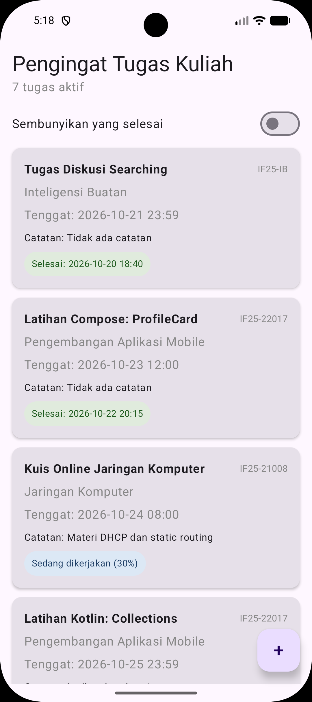
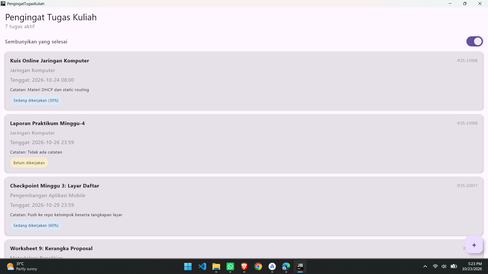

# Pengingat Tugas Kuliah

**Tema 2 | PAM Kelompok 06**

Aplikasi Kotlin Multiplatform dengan Compose Multiplatform yang menargetkan Android dan Desktop (JVM).

Proyek kelompok mata kuliah **IF25-22017 Pengembangan Aplikasi Mobile**, Program Studi Teknik Informatika, Fakultas Teknologi Industri, Institut Teknologi Sumatera (ITERA).
Dosen pengampu: Muhammad Habib Algifari, S.Kom., M.T.I.

## Anggota Kelompok

Ketua kelompok: Yoga Aditomo

| No | Nama                       | NIM       |
|----|----------------------------|-----------|
| 1  | Yoga Aditomo               | 124140081 |
| 2  | Guntur Anggoro Rahardianto | 124140105 |
| 3  | Muhammad Radhitya Hammam   | 124140189 |

## Pembagian Kerja (Minggu 3)

| Bagian | Dikerjakan oleh |
|--------|--------------|
| Folder Week 3, `DaftarTugas`, `LayarDaftar` (LazyColumn, FAB, switch filter), pembaruan `App.kt`, tangkapan layar | Muhammad Radhitya Hammam |
| `DataDummyTugas` (10 data), `TugasOlah` (urut dan filter), `TugasOlahTest` | Guntur Anggoro Rahardianto |
| `LabelStatus`, `KartuTugas`, README | Yoga Aditomo |

## Tangkapan Layar

| Android | Desktop |
|--|--|
|  |  |

## Isi Aplikasi Saat Ini

- Layar daftar tugas memakai `LazyColumn` dengan 10 data dummy dari `Tugas` minggu lalu.
- Setiap tugas tampil sebagai `KartuTugas` berisi judul, mata kuliah, tenggat, catatan, dan `LabelStatus` dari sealed class `StatusTugas`.
- Daftar diurutkan berdasarkan tenggat terdekat (`sortedBy`). Switch "Sembunyikan yang selesai" menyaring tugas dengan `filter`.
- Tombol `+` (FloatingActionButton) di pojok kanan bawah, belum berfungsi.

## Komponen UI

Semua ada di `shared/src/commonMain/kotlin/id/ac/itera/pengingattugas/ui/`.

| Berkas            | Keterangan                                                          |
|-------------------|---------------------------------------------------------------------|
| `LabelStatus.kt`  | Label berbentuk pil, warnanya mengikuti `StatusTugas`                |
| `KartuTugas.kt`   | Kartu satu tugas, punya parameter `ringkas` dan `onKlik`             |
| `DaftarTugas.kt`  | `LazyColumn` dengan `key = { it.id }`                                |
| `LayarDaftar.kt`  | Scaffold, judul, switch filter, daftar, dan FAB                      |

## Pengolahan Data

`model/TugasOlah.kt` berisi `urutkanTenggat()` dan `belumSelesai()`. Datanya ada di `data/DataDummyTugas.kt`. Kedua fungsi diuji di `TugasOlahTest`.

## Cara Menjalankan

**Android**

```
./gradlew :androidApp:assembleDebug
```

**Desktop**

```
./gradlew :desktopApp:run
```

## Menjalankan Test

```
./gradlew :shared:jvmTest
```