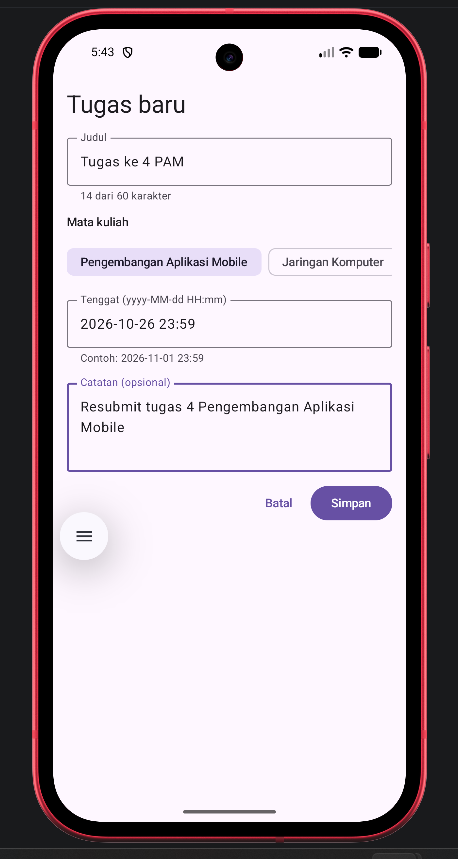
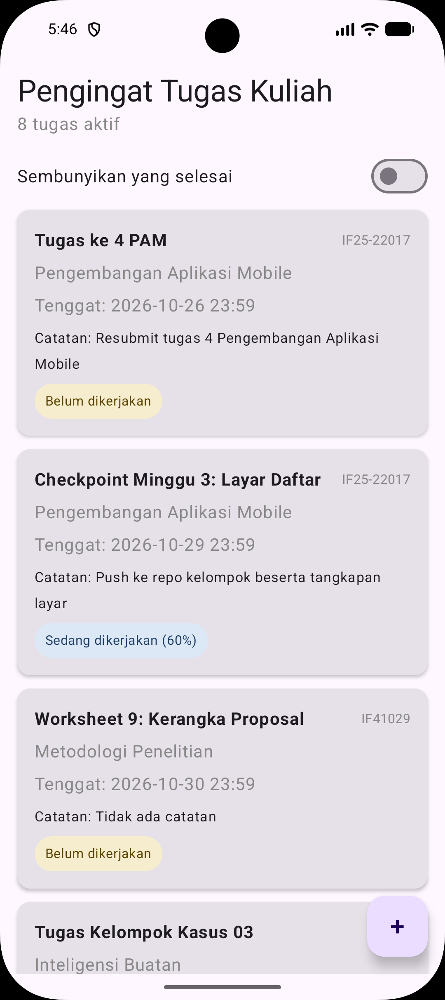
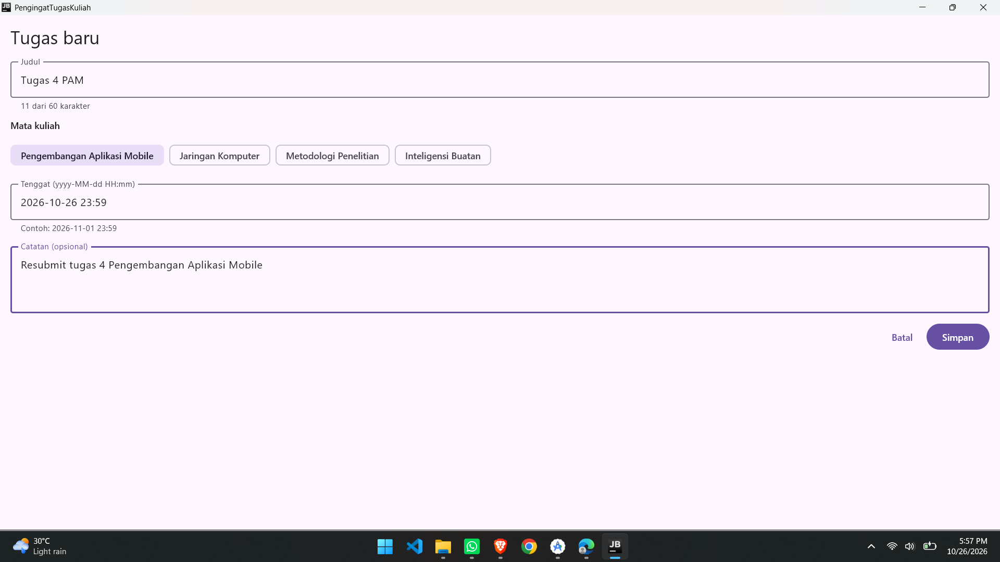
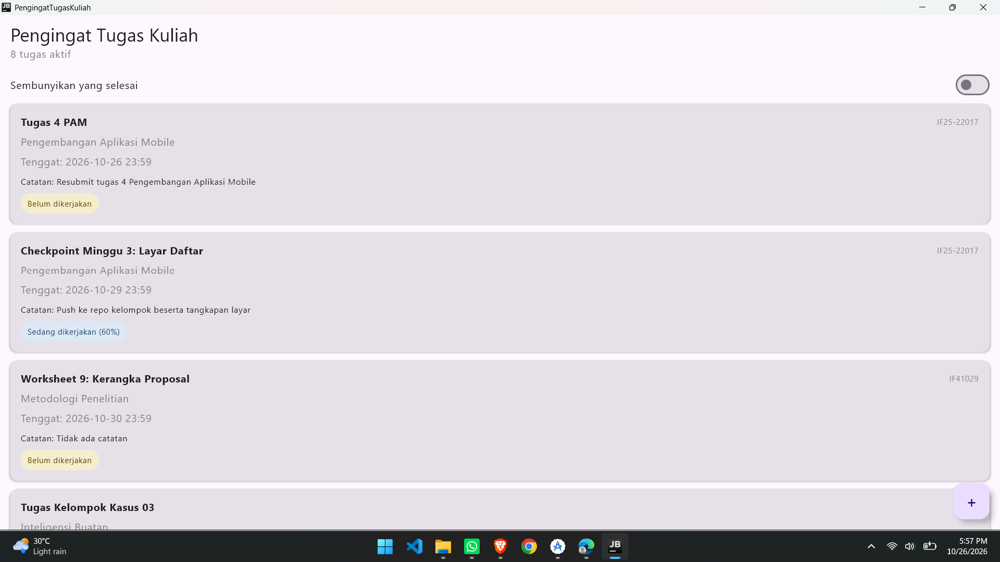

# Pengingat Tugas Kuliah

**Tema 2 | PAM Kelompok 06**

Aplikasi Kotlin Multiplatform dengan Compose Multiplatform yang menargetkan Android dan Desktop (JVM).

Proyek kelompok mata kuliah **IF25-22017 Pengembangan Aplikasi Mobile**, Program Studi Teknik Informatika, Fakultas Teknologi Industri, Institut Teknologi Sumatera (ITERA).
Dosen pengampu: Muhammad Habib Algifari, S.Kom., M.T.I.

## Anggota Kelompok

Ketua kelompok: Yoga Aditomo

| No | Nama                       | NIM       |
|----|----------------------------|-----------|
| 1  | Yoga Aditomo               | 124140081 |
| 2  | Guntur Anggoro Rahardianto | 124140105 |
| 3  | Muhammad Radhitya Hammam   | 124140189 |

## Pembagian Kerja (Minggu 4)

| Bagian | Dikerjakan oleh |
|--------|--------------|
| `SumberDaftarTugas`, `SumberDaftarTugasPalsu` (MutableStateFlow), `PilihanMataKuliah`, `SumberDaftarTugasPalsuTest` | Guntur Anggoro Rahardianto |
| Folder Week 4, `FormTugasUiState`, `FormTugasViewModel`, `FormTugasViewModelTest`, README | Yoga Aditomo |
| `KolomTeks`, `FormTugasScreen`, pembaruan `LayarDaftar` dan `App.kt`, tangkapan layar | Muhammad Radhitya Hammam |

## Tangkapan Layar

| Form tugas baru | Daftar setelah tugas ditambah |
|--|--|
|  |  |
|  |  |

## Isi Aplikasi Saat Ini

- Layar daftar tugas dari minggu 3 tetap ada: `LazyColumn`, kartu tugas dengan `LabelStatus`, urut berdasarkan tenggat terdekat, dan switch "Sembunyikan yang selesai".
- Tombol `+` (FloatingActionButton) sekarang membuka form **Tugas baru**.
- Form berisi kolom judul (maksimal 60 karakter), pilihan mata kuliah, tenggat dengan format `yyyy-MM-dd HH:mm`, dan catatan opsional.
- Tombol Simpan hanya aktif kalau judul, mata kuliah, dan tenggat sudah terisi benar. Tombol ditekan dua kali tetap menambah satu tugas.
- Setelah disimpan, form tertutup dan tugas baru langsung tampil di layar daftar sesuai urutan tenggatnya.
- Isi form tidak hilang saat layar diputar karena state disimpan di `ViewModel`.
- Data masih disimpan di memori (sumber palsu), jadi hilang saat aplikasi ditutup. Penyimpanan sungguhan dikerjakan di minggu 6.

## Arsitektur (MVVM)

| Lapisan | Berkas | Tugasnya |
|---------|--------|----------|
| View | `FormTugasScreen`, `KolomTeks`, `LayarDaftar` | Menampilkan state dan meneruskan aksi pengguna, tanpa aturan bisnis |
| ViewModel | `FormTugasViewModel`, `FormTugasUiState` | Menyimpan state form, memvalidasi, dan memanggil sumber data |
| Model | `Tugas`, `SumberDaftarTugas`, `SumberDaftarTugasPalsu` | Data class dan sumber data palsu berbasis `MutableStateFlow` |

Kebiasaan yang dipakai: `bisaSimpan` dihitung dari nilai lain dan tidak disimpan sendiri, `MutableStateFlow` bersifat private dan hanya `StateFlow` yang publik, state diubah dengan `update { it.copy(...) }`, dan `KolomTeks` tidak menyimpan state sendiri (state turun, event naik).

## Cara Menjalankan

**Android**

```
./gradlew :androidApp:assembleDebug
```

**Desktop**

```
./gradlew :desktopApp:run
```
## Menjalankan Test

```
./gradlew :shared:allTests
```